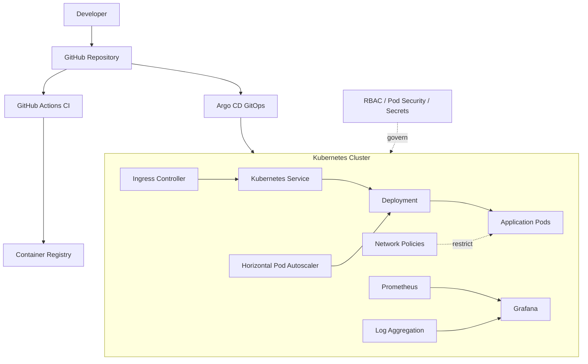

# Enterprise Kubernetes Platform

A cloud-native reference platform demonstrating production-oriented Kubernetes architecture, GitOps delivery, security guardrails, observability, and workload reliability.

> **Portfolio scope:** this repository is a deployable learning/reference blueprint. It does not claim that clusters have been provisioned in AWS, Azure, Google Cloud, or OCI. Cloud-specific infrastructure modules and live-cluster validation are roadmap items until implemented in a real account.

## Architecture



## Design goals

- Declarative, version-controlled Kubernetes workloads.
- GitOps-based continuous delivery with Argo CD.
- Least-privilege RBAC and workload security defaults.
- Resource requests/limits, probes, and autoscaling.
- Network segmentation using NetworkPolicy.
- Metrics, dashboards, and operational runbooks.
- Portability across managed Kubernetes services.

## Repository structure

```text
.
├── .github/workflows/ci.yml
├── apps/demo/
│   ├── deployment.yaml
│   ├── service.yaml
│   ├── ingress.yaml
│   ├── hpa.yaml
│   ├── pdb.yaml
│   ├── network-policy.yaml
│   └── kustomization.yaml
├── argocd/application.yaml
├── docs/
│   ├── architecture.md
│   ├── security-and-governance.md
│   ├── observability-and-sre.md
│   ├── disaster-recovery.md
│   └── adr/0001-platform-baseline.md
├── platform/namespaces.yaml
└── README.md
```

## Quick validation

Prerequisites: `kubectl`, `kustomize` (or kubectl with Kustomize support), and optionally `kubeconform`.

```bash
kubectl kustomize apps/demo
kubectl apply --dry-run=client -k apps/demo
kubectl apply --dry-run=client -f platform/namespaces.yaml
```

To deploy to a cluster, first review the security guide, replace the example image with an image you own, configure a real ingress controller and TLS, and review all resource sizing and network policies.

## Cloud portability roadmap

| Platform | Managed Kubernetes | Status |
|---|---|---|
| AWS | Amazon EKS | Architecture target; deployment module pending |
| Azure | Azure Kubernetes Service (AKS) | Architecture target; deployment module pending |
| Google Cloud | Google Kubernetes Engine (GKE) | Architecture target; deployment module pending |
| OCI | Oracle Kubernetes Engine (OKE) | Architecture target; deployment module pending |

## Roadmap

- [x] Kubernetes workload baseline with probes and resource controls
- [x] HPA and PodDisruptionBudget examples
- [x] NetworkPolicy and namespace baseline
- [x] GitOps application example
- [x] Security, SRE, DR, and architecture documentation
- [x] Manifest validation in CI
- [ ] Add container build and image scanning pipeline
- [ ] Add Terraform modules for EKS, AKS, GKE, and OKE
- [ ] Add external secrets integration
- [ ] Validate on disposable non-production clusters
- [ ] Add load testing and measured SLOs

## Author

**Jorge Rodriguez** — Enterprise Systems Engineer | Cloud & Solutions Architecture | Kubernetes | Multicloud | AI

- [LinkedIn](https://www.linkedin.com/in/jorge-rodriguez-n/)
- [GitHub](https://github.com/jorge2026)

---

This project is maintained as a practical architecture portfolio and learning reference.