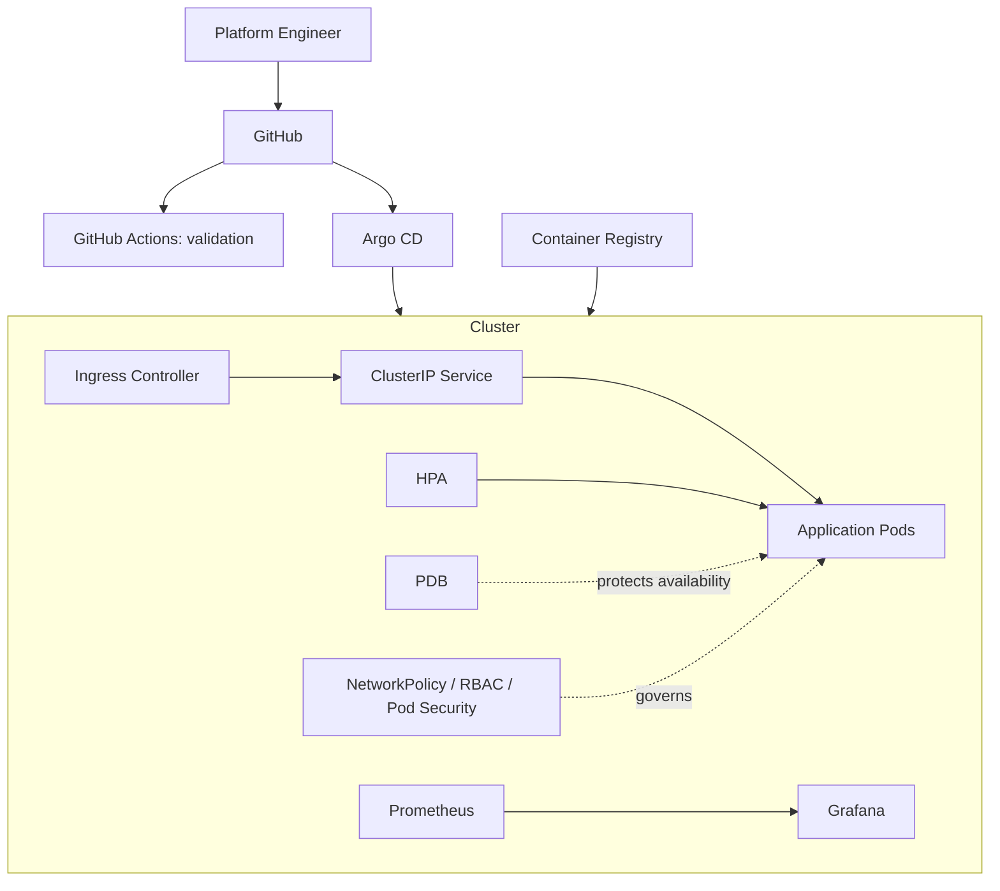

# Enterprise Kubernetes Platform Architecture

## Scope

This repository defines a reference platform baseline for cloud-native workloads. It includes Kubernetes manifests, GitOps examples, and architecture guidance. It does not provision managed clusters or install controllers in a cloud account.

## Logical architecture

## Platform layers

| Layer | Responsibility | Reference implementation |
|---|---|---|
| Developer workflow | Source control and review | GitHub |
| CI | Validate manifests and policy | GitHub Actions |
| Image supply chain | Build, scan, sign, store images | Planned integration |
| GitOps CD | Reconcile desired state | Argo CD Application example |
| Workload runtime | Schedule and run containers | Kubernetes Deployment |
| Networking | Service discovery and north-south traffic | Service and Ingress |
| Resilience | Replicas, probes, autoscaling, disruption budgets | Deployment, HPA, PDB |
| Security | Workload identity, least privilege, isolation | Pod security context, namespace labels, NetworkPolicy |
| Observability | Metrics, logs, traces, dashboards | Architecture target; installation pending |

## Workload lifecycle

1. A change is proposed through a pull request.
2. CI validates YAML and Kubernetes resource schemas.
3. A reviewed change is merged to the GitOps branch.
4. Argo CD detects the desired-state change and reconciles the target cluster.
5. Kubernetes schedules Pods and maintains the declared replica count.
6. Probes, resource requests, HPA, and PDB contribute to workload health and availability.

## Multicloud strategy

The workload layer is designed to remain portable across EKS, AKS, GKE, and OKE. Cloud-specific capabilities such as ingress controllers, load balancers, storage classes, identity federation, secrets integrations, and network policies require provider-specific configuration and validation.

Avoid assuming identical behavior, pricing, quotas, or managed control-plane features across providers.

## Architecture decisions

- Prefer managed Kubernetes for enterprise workloads unless a clear requirement justifies self-managed control planes.
- Keep application manifests cloud-neutral where practical.
- Isolate provider-specific infrastructure in Terraform modules and environment overlays.
- Use GitOps for auditable, repeatable deployment.
- Apply security controls at namespace, workload, network, and identity layers.
- Define service objectives from workload measurements rather than assumptions.
